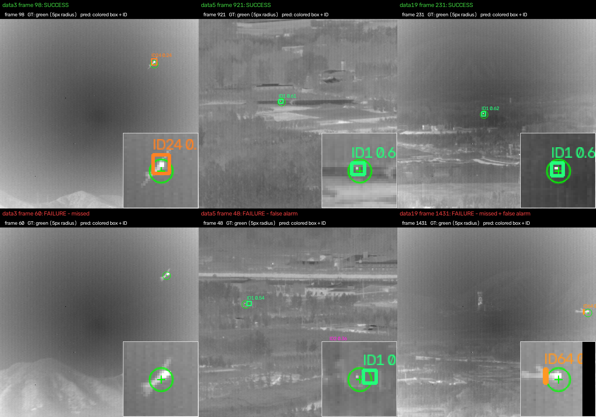

# Infrared Dim-Small Aircraft Detection & Tracking

Detection and multi-object tracking of 1–5 px aircraft in infrared video, on the
*IR dim-small aircraft target dataset* (Hui et al., Sci. Data Bank 2022 — 22 sequences,
16,177 frames, 256×256, point annotations only).

The project has two tracks:

- **Baseline (done):** YOLO11n fine-tuned on the dataset + BoT-SORT, following
  *Chen et al., "Strong Baseline: Multi-UAV Tracking via YOLOv12 with BoT-SORT-ReID"* (CVPRW 2025).
- **PISTTN (implemented, not yet trained):** *Zhou & Hu, "PISTTN: Profile-Aware Infrared Small
  Target Tracking Network"* (IEEE TGRS 2026), built from the paper's Table VII with 3-D sparse
  convolutions (spconv).

Full write-up: **[docs/report.md](docs/report.md)**.

## Results (test split: data3, data5, data19)

| Tracker | HOTA | MOTA | IDF1 | ID switches | F1@5 px |
|---|---|---|---|---|---|
| YOLO11n + BoT-SORT (defaults) | 0.372 | 0.900 | 0.257 | 22 | 0.952 |
| YOLO11n + BoT-SORT (16 px association padding) | **0.754** | 0.884 | **0.752** | **5** | 0.944 |

Detector: test mAP50 0.953 / mAP50-95 0.469 (synthetic boxes). Metrics match predictions to the
annotated points by center distance (5 px), since the dataset has no box labels.

The key finding: detection is easy, association is not. IoU matching on 5 px boxes breaks on
2–3 px of jitter, so boxes are padded by 16 px (chosen on the validation split) for association
only. See the report for per-sequence results, failure analysis and the padding sweep.



## Setup

Windows 11, Python 3.11, CUDA 12.6 GPU (developed on an RTX 3050 Laptop, 4 GB).

```powershell
python -m venv yolo-env
.\yolo-env\Scripts\pip install -r requirements.txt   # includes torch cu126 and spconv-cu126
$env:PYTHONPATH = "."
```

Place the raw dataset (not in the repo) as:

```
data/
  data1/data1/0.bmp ...      # 22 sequences
  data_label/data1.txt ...   # 22 label files
```

## Where to find each part

| Deliverable | File | Output |
|---|---|---|
| Whole pipeline, one command | `run_pipeline.py` | everything below |
| Data preprocessing (cleaning, PNG conversion, split) | `scripts/prepare_data.py` | `processed/` |
| Annotation: bounding boxes from point labels | `irtrack/boxes.py` (run by `prepare_data.py`) | `processed/seqs/*/labels`, `gt/gt.txt` |
| Label-file parsing | `irtrack/labels.py` | — |
| Target-size analysis | `scripts/measure_targets.py` | `processed/target_stats.json` |
| Training (YOLO11n) | `scripts/train_yolo.py` | `runs/yolo/yolo11n_ir/` |
| Testing / inference + tracking (YOLO + BoT-SORT) | `scripts/track_yolo.py`, `configs/botsort_ir.yaml` | `results/yolo_botsort/` |
| Metrics (HOTA, MOTA, IDF1, P/R@5) | `irtrack/metrics.py` | — |
| Evaluation of saved tracks | `scripts/evaluate.py` | printed table / JSON |
| Video rendering | `scripts/render_videos.py` | `results/videos/` |
| Report figures | `scripts/make_figures.py` | `results/figures/` |
| Report | `docs/report.md` | — |
| Unit tests | `tests/test_core.py` | — |
| PISTTN model, training, inference | `irtrack/pisttn/`, `scripts/train_pisttn.py`, `scripts/track_pisttn.py` | `runs/pisttn/`, `results/pisttn/` |

## Pipeline

One command runs the baseline end to end (data and training are skipped when their outputs
already exist; `--force` redoes them):

```powershell
python run_pipeline.py                                   # data, train, track, evaluate, videos, figures
python run_pipeline.py --stages track evaluate videos    # selected stages only
python tests\test_core.py                                # unit tests
```

Or step by step:

```powershell
# 1. Data: PNG frames, synthesized boxes, YOLO + MOT labels, sequence-level split -> processed/
python scripts\prepare_data.py

# 2. Baseline: train, then track + evaluate
python scripts\train_yolo.py --workers 0
python scripts\track_yolo.py --weights runs\yolo\yolo11n_ir\weights\best.pt --split val  --pad 16
python scripts\track_yolo.py --weights runs\yolo\yolo11n_ir\weights\best.pt --split test --pad 16
python scripts\evaluate.py --pred-dir results\yolo_botsort --split test

# 3. Videos and report figures -> results/
python scripts\render_videos.py
python scripts\make_figures.py all

# 4. PISTTN (not yet trained)
python scripts\train_pisttn.py --stage 1
python scripts\train_pisttn.py --stage 2 --init runs\pisttn\stage1\best.pt
python scripts\track_pisttn.py --weights runs\pisttn\stage2\best.pt --split test
```

Analysis helpers: `scripts\measure_targets.py` (target sizes), `scripts\check_sparsify.py`
(how many targets survive PISTTN's t-SVD sparsification).

`--workers 0` is needed on Windows here; multi-worker data loading stalled.

## Data split

| Split | Sequences | Frames |
|---|---|---|
| train | data1, 4, 7–15, 17, 18, 20–22 | 9,981 |
| val | data2, data6, data16 | 1,497 |
| test | data3, data5, data19 | 4,699 |

Split by sequence, so no frames from one video leak across splits.

## Repository layout

```
run_pipeline.py      runs all stages in order
irtrack/             library code
  labels.py          label-file parser
  boxes.py           box synthesis from point annotations
  metrics.py         HOTA, CLEAR-MOT, IDF1, P/R@5 on center distance
  pisttn/            PISTTN: t-SVD, model, data, losses, decoding, segment tracker
scripts/             runnable steps (see Pipeline)
tests/               unit tests on synthetic data
configs/             BoT-SORT tracker config
docs/                report, project audit
results/             metrics, track files, figures
```

Not tracked (see `.gitignore`): `data/`, `processed/`, `runs/` (weights), videos, `yolo-env/`.
