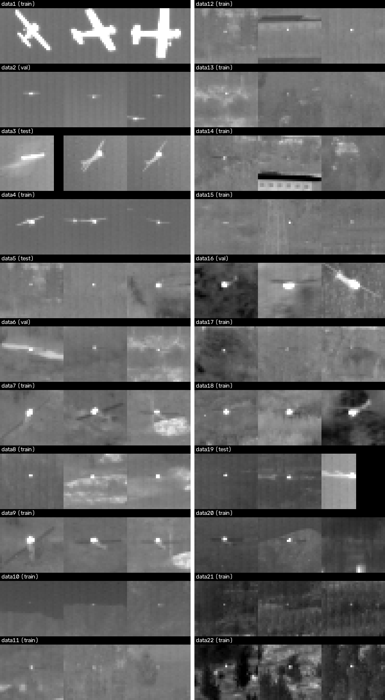
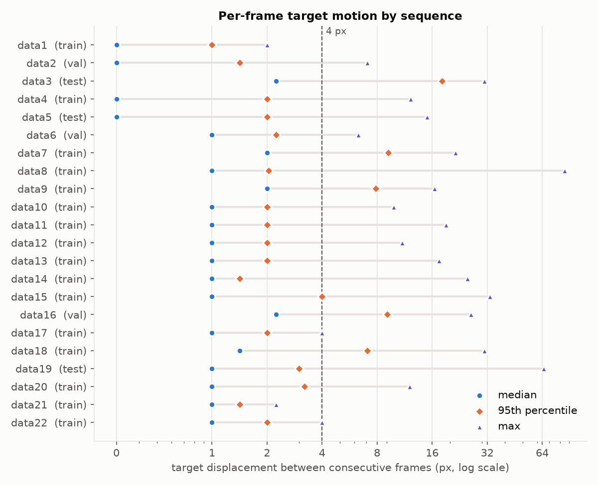
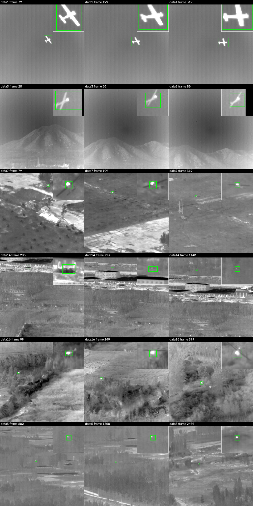
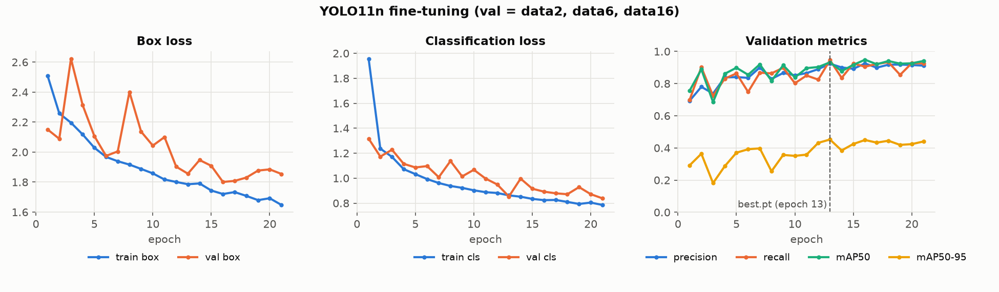
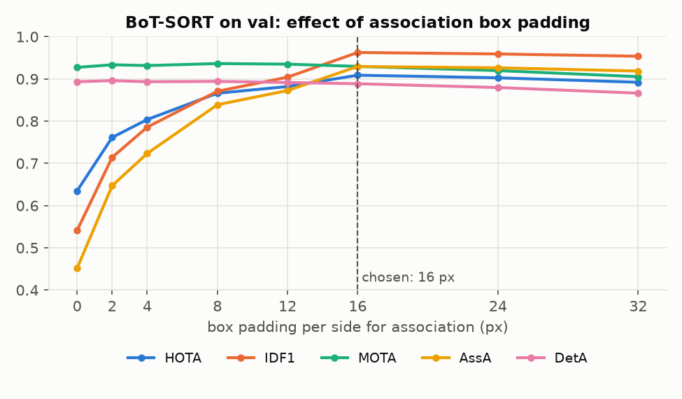
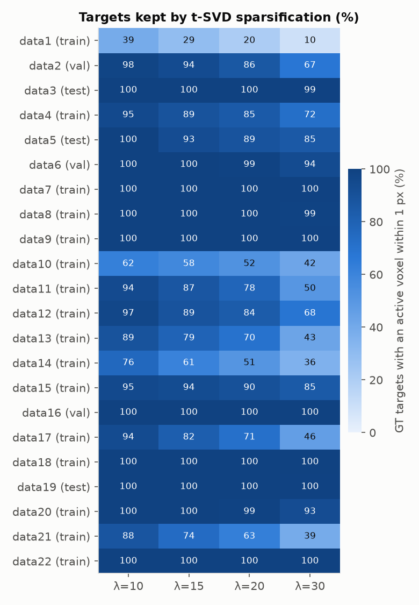

# Infrared Dim-Small Aircraft Detection & Tracking — MVP Report

**Project:** MiniProject · **Date:** 2026-10-29 · **Hardware:** RTX 3050 Laptop (4 GB), Windows 11, Python 3.11, PyTorch 2.14 + CUDA 12.6

---

## 1. Introduction

Infrared (IR) small-target tracking is hard: targets are often 1–5 px, have no texture or shape, sit against cluttered ground and sky backgrounds, and the camera itself moves. This MVP builds a complete, reproducible, *measured* pipeline on a public IR dim-small aircraft dataset:

1. **Data preparation** — cleaned labels, synthesized bounding boxes from point annotations, lossless single-channel frames, and a leakage-free sequence-level split.
2. **Strong baseline** — YOLO11n fine-tuned on the dataset, tracked with BoT-SORT, following *Chen et al., "Strong Baseline: Multi-UAV Tracking via YOLOv12 with BoT-SORT-ReID" (CVPRW 2025)*.
3. **Evaluation** — HOTA, MOTA, IDF1 and center-distance Precision/Recall@5 px, computed on point ground truth.
4. **PISTTN** (*Zhou & Hu, TGRS 2026*) — implemented layer-by-layer from the paper's Table VII with real 3-D sparse convolutions (spconv); verified end to end but **not yet trained** (see §8).

The dataset is the one cited as reference [32] in the PISTTN paper: *Hui et al., "A dataset for infrared image dim-small aircraft target detection and tracking under ground/air background", Sci. Data Bank, 2022.*

---

## 2. Dataset analysis

### 2.1 Overview

| Property | Value |
|---|---|
| Sequences | 22 (`data1` … `data22`) |
| Frames | 16,177 (all 256×256) |
| Raw storage | 24-bit BMP, 3,034 MiB — all three channels identical (grayscale) |
| Annotation | per frame: object ID + **center point (x, y) only — no boxes** |
| Class | single class (aircraft) |
| Targets per frame | 0–2; 17 sequences have one continuous target |

Label quirks handled by the parser (`irtrack/labels.py`): CRLF line endings, empty tab-separated header fields (`data18`–`data22`), a trailing label line with no image (`data1.txt`, frame 399), and header sequence names that do not match the file names (e.g. `data10.txt` says `data1`), which suggests the dataset was renumbered.

### 2.2 Target size

Measured on 720 sampled annotations (`scripts/measure_targets.py`) as the half-maximum blob around the annotated point:

| | p10 | median | p90 |
|---|---|---|---|
| width (px) | 1 | **2** | 12 |
| height (px) | 1 | **2** | 8 |
| contrast vs. local background (gray levels) | 48 | 121 | 172 |

Most targets are **1–5 px hot spots** (median core 2×2 px). The exceptions are `data1` (a full aircraft silhouette, ~30 px), parts of `data3` and late `data16` (the aircraft approaches). 97% of targets are brighter than the background.


*33×33 px crops around the annotated point (first / middle / last annotated frame per sequence, 4× nearest-neighbour).*

### 2.3 Target motion



Median motion is 0–2 px/frame, but camera shake produces **jumps of 30–85 px** between consecutive frames (`data8` max 85 px, `data19` 65 px, `data3` p95 = 18 px). Any tracker that gates association on small displacements or box overlap will fragment on these sequences. Numbers: `results/figures/motion_stats.csv`.

---

## 3. Methodology

### 3.1 Bounding-box synthesis (`irtrack/boxes.py`)

YOLO needs boxes; the dataset has only points. A single fixed box size would be wrong for both regimes (1–5 px dots vs. 30 px silhouettes), so each box is measured:

1. Estimate local background as the median of the border of a 49×49 patch around the point.
2. Find the peak within 3 px of the annotation; threshold at **half maximum** (FWHM) and take the connected component containing the peak.
3. If that component reaches the patch border it has merged with background structure (e.g. bright buildings in `data14`): raise the threshold (0.65, 0.8, 0.95 × peak) until it does not. Sides clipped by the image edge do not count.
4. Box = symmetric extent around the annotated point + 1 px padding, clamped to [5, 48] px.
5. Per track: cap each frame at 2× the track's median size, then a 7-frame temporal median filter.

Boxes stay centered on the annotated point, so center-based evaluation is unaffected by the synthesis. Result: median box 5×5 px for point targets, 29×27 for `data1`, 15×11 for `data3`; the worst `data14` clutter merge shrank from ~30 px to ≤13 px.


*Synthesized boxes on full frames (green), with a zoom inset around the target.*

### 3.2 Image conversion

Frames are stored as single-channel 8-bit PNG (`processed/seqs/<seq>/images/`), **verified lossless** against the source BMPs: 3.0 GB → 640 MB. Labels are written in three formats per sequence: YOLO (`labels/*.txt`), MOT (`gt/gt.txt`) and the original points (`gt/centers.txt`).

### 3.3 Sequence-level split (`processed/splits.json`)

Frames within a sequence are near-duplicates, so the split is by **sequence**; no sequence contributes to more than one split.

| Split | Sequences | Frames | Why these |
|---|---|---|---|
| train | 16: data1, 4, 7–15, 17, 18, 20–22 | 9,981 | everything else |
| val | data2, data6, data16 | 1,497 | two simultaneous targets (data2); approaching target (data16) |
| test | data3, data5, data19 | 4,699 | sequential targets with gaps (data3), long 3,000-frame track (data5), 5 sequential targets (data19) |

The plan document listed `data5`/`data6` both in train and in held-out sets and quoted approximate counts; the split above resolves that (train = all non-held-out sequences) and the counts are exact.

### 3.4 Detector: YOLO11n (`scripts/train_yolo.py`)

| Setting | Value | Rationale |
|---|---|---|
| Model | YOLO11n, COCO-pretrained | nano models do best on tiny targets (Paper 1); fits 4 GB |
| Input size | 512 (2× upsample of 256) | YOLO's finest stride is 8 px — a 5 px target at native size is under one cell |
| Optimizer | AdamW, lr 1e-3, cosine schedule, AMP | per plan |
| Augmentation | no hue/saturation jitter (grayscale), brightness ±0.3, scale ±0.25, flips, mosaic on (closed for the last 10 epochs) | mild scale jitter so 1–3 px targets don't vanish |
| Epochs | 50 planned, stopped at 21 (plateau); `best.pt` = epoch 13 | §5.1 |
| Batch | 16 (~1.5 GB VRAM) | |

### 3.5 Tracker: BoT-SORT (`configs/botsort_ir.yaml`, `scripts/track_yolo.py`)

| Setting | Value | Note |
|---|---|---|
| Tracker | BoT-SORT (Ultralytics) | Kalman filter + camera-motion compensation |
| `track_high_thresh` / detection conf | 0.20 | per plan |
| NMS IoU | 0.30 | |
| `track_buffer` | 60 | best value in Paper 1 |
| GMC | `sparseOptFlow` (LK optical flow + RANSAC affine) | |
| ReID | off | a 5×5 px crop carries no appearance information |
| **Association box padding** | **16** px per side (tuned on val) | see below |

**Box padding for association.** BoT-SORT associates by IoU. For a 5 px box a 2–3 px prediction error or camera jitter drops IoU to zero and a new track ID is spawned: with the final weights and no padding, the single target in `data5` receives 34 different track IDs. Detections are therefore grown by *p* px per side before they reach the tracker and shrunk back afterwards (a callback on `on_predict_postprocess_end`; centers are unchanged). *p* is chosen on the **validation** split only (§5.2). Ultralytics has no `min_box_area` filter, so the plan's setting is not applicable — no small boxes are dropped.

Inference runs sequence by sequence with a fresh model/tracker and `torch.cuda.empty_cache()` between sequences.

---

## 4. Evaluation protocol (`irtrack/metrics.py`)

GT boxes are synthetic, but GT **points** are the real annotations, so every metric matches on **center distance**, not IoU:

| Metric | Definition here |
|---|---|
| **P@5 / R@5 / F1@5** | per frame Hungarian matching; a prediction is a TP if within **5 px** of a GT point (the paper's Precision@5) |
| **MOTA** | 1 − (FN + FP + IDSW) / GT with the 5 px gate; MOTP = mean matched distance (px) |
| **IDF1** | global ID-level bipartite matching on frames where the IDs are within 5 px |
| **HOTA** | TrackEval algorithm with similarity *S* = max(0, 1 − d/10 px), averaged over α = 0.05…0.95; DetA, AssA, LocA reported |

Predicted box centers (continuous coordinates) are converted to the GT's pixel-index convention (−0.5 px). Per-split numbers pool all sequences of the split (frame and ID spaces offset so sequences never mix).

**Sanity checks** (data19): perfect prediction → every metric = 1; one global ID swap at frame 500 → MOTA 0.999, IDSW 1, IDF1 0.643, HOTA 0.70; empty prediction → 0. The PISTTN segment tracker fed with GT points scores HOTA 0.97–1.00 on data2/data5/data19.

---

## 5. Results

### 5.1 Detector training



Training was planned for 50 epochs (~4.7 min/epoch once the GPU was not shared) and **stopped after epoch 21**: validation mAP had plateaued at mAP50 ≈ 0.92–0.95 / mAP50-95 ≈ 0.42–0.45 since epoch 13, with no new best for 8 epochs. `best.pt` = **epoch 13** (Ultralytics fitness = 0.1·mAP50 + 0.9·mAP50-95). Consequence: the mosaic-off phase of the schedule (last 10 of 50 epochs) never ran.

Box-level detection quality of `best.pt` (Ultralytics `val`, synthetic GT boxes, `results/yolo_detection_metrics.json`):

| Split | Precision | Recall | mAP50 | mAP50-95 |
|---|---|---|---|---|
| val | 0.935 | 0.950 | 0.934 | 0.447 |
| test | 0.971 | 0.951 | 0.953 | 0.469 |

The low mAP50-95 relative to mAP50 is expected: at high IoU thresholds a 1 px offset on a 5 px box is already a miss.

### 5.2 Choosing the association padding (validation only)



| Pad (px/side) | 0 | 2 | 4 | 8 | 12 | **16** | 24 | 32 |
|---|---|---|---|---|---|---|---|---|
| val HOTA | 0.635 | 0.761 | 0.804 | 0.866 | 0.882 | **0.909** | 0.903 | 0.892 |
| val IDF1 | 0.541 | 0.714 | 0.786 | 0.871 | 0.904 | **0.963** | 0.959 | 0.954 |
| val IDSW | 14 | 8 | 7 | 3 | 2 | **1** | 1 | 0 |

Detection (DetA ≈ 0.89, F1@5 ≈ 0.97) is unaffected by the padding; association (AssA) rises from 0.45 to 0.93. Above 16 px, padded boxes of nearby objects start to overlap and FP/FN rise. **16 px was fixed before the test set was run.**

### 5.3 Final tracking results — YOLO11n + BoT-SORT (pad 16)

**Test** (`results/yolo_botsort/metrics_test.json`):

| Sequence | HOTA | DetA | AssA | MOTA | IDF1 | IDSW | P@5 | R@5 | F1@5 | MOTP (px) |
|---|---|---|---|---|---|---|---|---|---|---|
| data3 (100 fr.) | 0.093 | 0.062 | 0.138 | −0.562 | 0.149 | 0 | 0.164 | 0.137 | 0.149 | 2.39 |
| data5 (3,000 fr.) | 0.702 | 0.891 | 0.554 | 0.923 | 0.680 | 1 | 0.943 | 0.982 | 0.962 | 0.52 |
| data19 (1,599 fr.) | 0.877 | 0.843 | 0.913 | 0.876 | 0.930 | 4 | 0.909 | 0.976 | 0.941 | 0.61 |
| **all (pooled)** | **0.754** | 0.854 | 0.666 | **0.884** | **0.752** | 5 | 0.922 | 0.966 | **0.944** | 0.55 |

**Validation** (`results/yolo_botsort/metrics_val.json`):

| Sequence | HOTA | DetA | AssA | MOTA | IDF1 | IDSW | P@5 | R@5 | F1@5 | MOTP (px) |
|---|---|---|---|---|---|---|---|---|---|---|
| data2 | 0.954 | 0.954 | 0.954 | 0.998 | 0.999 | 0 | 1.000 | 0.998 | 0.999 | 0.55 |
| data6 | 0.939 | 0.927 | 0.952 | 0.972 | 0.986 | 0 | 0.973 | 1.000 | 0.986 | 0.59 |
| data16 | 0.788 | 0.734 | 0.845 | 0.729 | 0.863 | 1 | 0.813 | 0.949 | 0.876 | 0.72 |
| **all (pooled)** | **0.909** | 0.889 | 0.929 | **0.930** | **0.963** | 1 | 0.945 | 0.987 | **0.966** | 0.60 |

### 5.4 Ablation: association padding on test

| Test (pooled) | HOTA | AssA | MOTA | IDF1 | IDSW | F1@5 |
|---|---|---|---|---|---|---|
| BoT-SORT, pad 0 (default) | 0.372 | 0.158 | 0.900 | 0.257 | 22 | 0.952 |
| BoT-SORT, pad 16 | **0.754** | **0.666** | 0.884 | **0.752** | **5** | 0.944 |

Per sequence, pad 0 → 16: data5 IDF1 0.19 → 0.68 (34 → 15 track IDs on a single-target sequence), data19 IDF1 0.41 → 0.93.

### 5.5 Speed and camera-motion compensation

| | data3 | data5 | data19 | data2 | data6 | data16 |
|---|---|---|---|---|---|---|
| FPS (end to end, incl. PNG decode) | 11.5* | 24.1 | 23.2 | 21.4 | 23.6 | 24.7 |
| GMC fallback rate | 0% | 0% | 0% | **81%** | 0% | 0% |

\*data3 is 100 frames, so model warm-up dominates. GMC fallback = frames where sparse optical flow found too few feature matches and BoT-SORT assumed no camera motion; `data2` is plain sky.

### 5.6 Qualitative results


*Top: successes. Bottom: a missed aircraft silhouette (data3), a false alarm beside a correct track (data5), a missed target with a false alarm on a nearby structure (data19). Green circle = GT point with the 5 px match radius; inset = 3× zoom.*

Annotated videos of the test sequences (768×768, predicted boxes + IDs, GT points): `results/videos/yolo_botsort_data3.mp4`, `…_data5.mp4`, `…_data19.mp4`.

---

## 6. Discussion

**Detection is largely solved for point targets; association was the real problem.** On test, F1@5 is 0.94–0.96 for both tracker settings, yet the default BoT-SORT reaches only HOTA 0.37 / IDF1 0.26. The cause is IoU-based association on 5 px boxes: a 2–3 px prediction error — common with the camera jitter measured in §2.3 — gives IoU = 0 and a new ID. Padding boxes by 16 px for association only doubles HOTA (0.37 → 0.75) and triples IDF1 (0.26 → 0.75) with no change to the detector. This matches Paper 1's point that tiny-target tracking is dominated by "area-based" settings, and it is the main practical finding of this MVP. A distance-based association cost would be the principled version of the same fix.

**The remaining test errors have three distinct causes.**
1. *data3 — detector failure on a large, partially visible silhouette* (F1@5 0.15). The aircraft is 15–27 px, against bright sky, often clipped by the image border; the nearest prediction is a median 112 px away. Only `data1` in training shows a comparable silhouette, so this is a coverage gap in the training set rather than a resolution problem. Box mAP on the pooled test set (0.95) hides it because data3 is 2% of test frames — per-sequence reporting matters here.
2. *data5 — one long loss.* ID 1 holds for 2,083 frames, then the track is lost for more than `track_buffer` = 60 frames around frame 2,200 and resumes as ID 45. One event halves IDF1 (0.68) and AssA (0.55) while MOTA stays 0.92 — a good illustration of why HOTA/IDF1 are reported alongside MOTA.
3. *data19 / data16 — false alarms on clutter.* P@5 0.81–0.91: bright structures (pylons, buildings) fire as targets. Temporal evidence — exactly what PISTTN's 10-frame tensor provides — is the natural fix.

**Camera-motion compensation is not reliable on IR.** Sparse optical flow fails on 81% of frames in the sky sequence `data2`. That sequence still tracks perfectly (two slow targets), but GMC cannot be relied on to absorb the 30–85 px jumps in ground-background sequences either; the large association padding is effectively doing that job.

**Validation vs. test.** Val (HOTA 0.909) is easier than test (0.754). Removing data3 barely changes the test score (data5 + data19 pooled: HOTA 0.764, MOTA 0.908, IDF1 0.761, F1@5 0.956), because data3 is only 100 frames; the gap is mostly the single 60+ frame dropout in the 3,000-frame data5, which no val sequence contains. With only 3 + 3 held-out sequences, a single tracking event can move the pooled score by this much.

---

## 7. Limitations

- **Synthetic boxes.** Box sizes come from a half-maximum heuristic, not human labels. They only affect detector training and the box-based mAP; tracking metrics use the real point annotations.
- **Small, imbalanced test set.** Three test sequences, 4,699 frames, of which `data5` is 64%. Combined scores are dominated by `data5`; per-sequence numbers are reported for that reason.
- **One split, one seed.** No cross-validation over sequence folds; the variance from the split choice is unknown.
- **Center-distance metrics** differ from the IoU-based HOTA/MOTA in most published MOT tables, so numbers are not directly comparable to the PISTTN paper.
- **GT identity ambiguity.** In `data3`, `data16` and `data19` a new GT ID appears where the previous aircraft vanished; motion-based trackers merge them. Even oracle detections give IDF1 0.69 (`data3`) and 0.64 (`data16`) with the PISTTN tracker.

---

## 8. Future work — PISTTN

PISTTN is **implemented but not trained**. What exists (`irtrack/pisttn/`, `scripts/train_pisttn.py`, `scripts/track_pisttn.py`):

| Component | Status |
|---|---|
| t-SVD sparsification (Eqs. 1–4; rank 1, λ = 20, T = 10) | done, GPU |
| STE encoder: 11 DSBlocks, strides (1,2,2) at DSBlock3/5/7 (Table VII) | done, spconv 2.3.8 `SubMConv3d`/`SparseConv3d` |
| STQ decoder: ResBlock1–4, DSBlock9–13, USBlock1–3 (inverse sparse conv) | done; skip/up-path voxel alignment verified |
| Query heads *head_l* (128→256→256→2) and *head_h* (16→256→256→2); Q = Q_l↑ + Q_h | done |
| Profile detector: 2 SPCBLs (2→16 3×3×3, 16→6 1×1×1) on 4-frame segments with 1-frame overlap | done |
| Losses: focal (α 0.25, γ 2), CIoU; 0.1·L_ss + 2.0·L_CIoU | done |
| Segment tracker (Eqs. 10–11, λ = β = 0.5) | done; GT-oracle test HOTA 0.97–1.00 |
| Two-stage training (150 + 50 epochs, SGD 1e-4, batch 1) | **not run** |

**Clearing the critical blocker from the audit.** `spconv-cu126` 2.3.8 installs from a Windows wheel and runs forward and backward on the RTX 3050, so the dense fallback in the plan is unnecessary. One forward + backward pass on a 10-frame clip takes ~0.13 s and < 0.5 GB VRAM.

**Interpretation choices** (Table VII vs. the text; documented in `irtrack/pisttn/model.py`):
- rows with padding 0 are treated as submanifold convolutions (a non-padded 3×3×3 conv would shrink T = 10 to zero over 11 blocks);
- "DSBlock6×2: 32→64, stride (1,2,2)" is a typo; it is implemented as 64→64, stride 1, consistent with Table VI (11 blocks → 1/8 resolution);
- the two query heads have different input widths in Table VII, so they cannot share weights as the text claims — two heads are used;
- the 6 detector outputs are interpreted as (Δx, Δy, log w, log h, v_x, v_y);
- the focal loss is normalized by the number of positive voxels instead of H·W (Eq. 16) so that gradients are usable at lr 1e-4.

**Finding that bounds PISTTN on this dataset.** At the paper's λ = 20, t-SVD keeps only 20% of targets in `data1`, ~51% in `data10`/`data14` and 63% in `data21`: slow or large targets are absorbed into the rank-1 background. The test sequences are unaffected (data3 100%, data5 89%, data19 100%). λ is a parameter; λ = 10–15 raises recall at 2–4× the voxel count.



Full table: `results/figures/tsvd_recall.md`.

**Next steps.**
1. Fix the crash on windows with zero active voxels (patched in `build_input`, untested in a full run), then a 1,500-iteration pilot comparing the paper's SGD 1e-4 to AdamW 1e-3.
2. Training budget: the paper's 150 + 50 full epochs at batch 1 is ~60 h on this GPU. A realistic plan is ~20 k stage-1 + ~10 k stage-2 iterations (≈ 1.5 h at ~7 it/s) and then extending if the validation query recall is still rising.
3. Evaluate with `scripts/track_pisttn.py` under the same protocol and add a column to the results table; ablate λ ∈ {10, 15, 20}.
4. For the baseline: try a distance-based association cost (instead of padded IoU), YOLO at 768 px, and per-sequence error analysis on `data19`.

---

## 9. Reproduction

```powershell
# environment
python -m venv yolo-env; .\yolo-env\Scripts\pip install -r requirements.txt
$env:PYTHONPATH = "."

# Phase 1: data
python scripts\measure_targets.py                 # target-size statistics
python scripts\prepare_data.py                    # -> processed/ (PNG frames, YOLO/MOT labels, splits)
python scripts\check_sparsify.py --csv results\figures\tsvd_recall.csv

# Phase 2: baseline
python scripts\train_yolo.py --workers 0          # -> runs/yolo/yolo11n_ir/weights/best.pt
python scripts\track_yolo.py --weights runs\yolo\yolo11n_ir\weights\best.pt --split val  --pad 16
python scripts\track_yolo.py --weights runs\yolo\yolo11n_ir\weights\best.pt --split test --pad 16
python scripts\render_videos.py                   # -> results/videos/
python scripts\make_figures.py all                # -> results/figures/

# Phase 3: PISTTN (not yet trained)
python scripts\train_pisttn.py --stage 1
python scripts\train_pisttn.py --stage 2 --init runs\pisttn\stage1\best.pt
python scripts\track_pisttn.py --weights runs\pisttn\stage2\best.pt --split test
```

`--workers 0` is required on this machine: with 4 dataloader workers the first training run stalled with the GPU idle.

### Repository layout

```
irtrack/            labels.py, boxes.py, metrics.py, pisttn/{sparsify,model,data,losses,decode,tracker}.py
scripts/            prepare_data, measure_targets, check_sparsify, train_yolo, track_yolo,
                    render_videos, make_figures, train_pisttn, track_pisttn
configs/            botsort_ir.yaml
processed/          generated dataset (frames, labels, splits.json, yolo_data.yaml)
runs/yolo/          YOLO training run (weights, results.csv)
results/            yolo_botsort/ (tracks + metrics), videos/, figures/
docs/               project_audit.md, report.md
```
